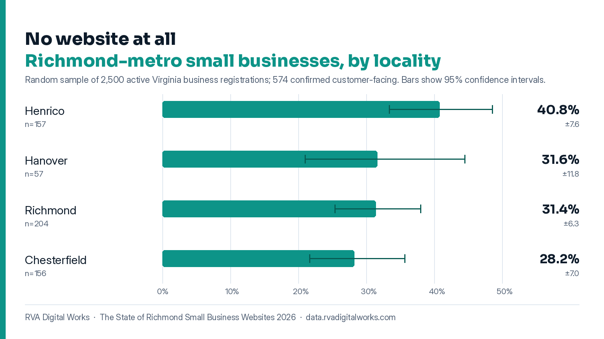

# rva-web-presence-study

How many small businesses around Richmond, Virginia have no website? I couldn't find a published number, so I measured it.

**About a third.** In a random sample of active registered businesses in Richmond, Henrico, Chesterfield and Hanover, 33.1% of the customer-facing ones had no website (95% interval 29.4% to 37.1%, 574 businesses). Henrico was highest at 40.8%.



This repo has the pipeline and aggregate results from my study of small business websites. The full report, methodology page and business-level dataset are published at [data.rvadigitalworks.com](https://data.rvadigitalworks.com) by my web design business, RVA Digital Works.

## Why a random sample

I already had a prospecting database for finding clients. Using it would have badly inflated the result. A lead list is built to find businesses that look underserved.

I used the whole state business registry instead. The random seed is published so anyone can draw the same sample and check my work.

## Method

1. **Sampling frame.** Every active corporation and LLC registered in Richmond city, Henrico, Chesterfield and Hanover, pulled from Virginia's State Corporation Commission files on [data.virginia.gov](https://data.virginia.gov). A business in both files is kept once. 46,543 entities.
2. **Exclusions, before sampling.** Holding companies, single-property LLCs, trusts, churches, foundations, HOAs and condo associations, by name. 3,074 excluded, each reason counted and published. 43,469 eligible.
3. **Sample.** 2,500 drawn with `random.Random(20260825)` from the eligible list in a fixed sort order. The seed is the run date.
4. **Customer-facing screen.** Google Places looks each business up. A business with a Google Business Profile counts as customer-facing. That's the only signal in the data that separates a business with customers from a shell. 574 passed.
5. **Website, from two sources.** Places' website field, plus a domain probe that tries likely domains for the business name and only accepts one that proves it belongs to this business (name, address or phone on the page, not a parked page). "No website" means both looked and neither found one.
6. **Site checks** on the 377 live sites: HTTPS, a mobile viewport, Schema.org structured data, `llms.txt`, robots.txt and whether it blocks AI crawlers, time to first byte, platform.
7. **Statistics.** Every figure is a Wilson score interval at 95%. It works at small samples and near 0% or 100%, where the textbook interval doesn't. Sectors and localities with fewer than 30 businesses aren't reported.

## Findings (2026 edition)

`python findings.py` prints this from `data/stats.json`:

| Finding | Share | 95% interval | Base |
|---|---|---|---|
| No website at all | 33.1% | 29.4 to 37.1 | 574 |
| Social page instead of a website | 1.2% | 0.6 to 2.5 | 574 |
| No valid HTTPS | 9.3% | 6.8 to 12.6 | 377 |
| No mobile viewport | 8.0% | 5.6 to 11.1 | 377 |
| No Schema.org structured data | 40.6% | 35.7 to 45.6 | 377 |
| No LocalBusiness/Organization schema | 58.1% | 53.1 to 63.0 | 377 |
| No llms.txt | 73.7% | 69.1 to 77.9 | 377 |
| Blocks at least one AI crawler | 2.4% | 1.3 to 4.5 | 377 |
| No robots.txt at all | 7.4% | 5.2 to 10.5 | 377 |
| No Google Business Profile found | 76.9% | 75.2 to 78.5 | 2,487 |
| Fewer than 10 Google reviews | 55.1% | 51.0 to 59.1 | 574 |

| No website at all, by locality | Share | 95% interval | Base |
|---|---|---|---|
| Henrico | 40.8% | 33.4 to 48.6 | 157 |
| Hanover | 31.6% | 21.0 to 44.5 | 57 |
| Richmond | 31.4% | 25.4 to 38.0 | 204 |
| Chesterfield | 28.2% | 21.7 to 35.7 | 156 |

`data/stats.json` also has the sector breakdown, platforms, the Schema.org types found and the exclusion counts.

## Run it

Tested on Python 3.13.

```bash
pip install -r requirements.txt

python run.py --sample -n 600 --seed 20260825      # free, no key, a couple of minutes
export GOOGLE_API_KEY=...                            # Windows: $env:GOOGLE_API_KEY = "..."
python run.py --audit                                # the run that matters
python findings.py                                   # the table above, from your run
```

The sample step only needs the public registry. The audit needs a Google Places (New) key. Google bills those lookups: about one text search per sampled business.

Without a key, the audit still finishes, but there's no customer-facing screen and no Business Profile figure. Every number is marked provisional. Set `STUDY_USER_AGENT` so the sites you probe can see who's asking.

`data/sample.json`, `data/audited.json` and the CSV are written locally and stay out of git. They hold business names and registered agents.

## Tests

```bash
python -m unittest discover -s tests -v
```

The tests don't touch the network. They check the Wilson intervals (including that they reproduce the published 33.1% and 40.8%), the exclusions, that the same seed draws the same sample in any input order, the statistics on made-up records, the domain guesses and the Schema.org reader.

## Limits

- **Registered name isn't trading name.** A business that trades under a different name can miss its Maps listing. That's most of why "no Google Business Profile" is so high. Those businesses drop out of the customer-facing base.
- **The screen leans on Google.** Customer-facing means "has a Business Profile". A real business with no profile isn't in the base.
- **The probe is strict on purpose.** It only accepts a domain that proves it belongs to the business. A site that never names its business or address can be missed.
- **One snapshot.** August 2026. The next edition re-runs with a new seed so the change over time can be measured.

## License

MIT for the code (see `LICENSE`). The figures in `data/stats.json` and the chart can be reused with credit to RVA Digital Works.
